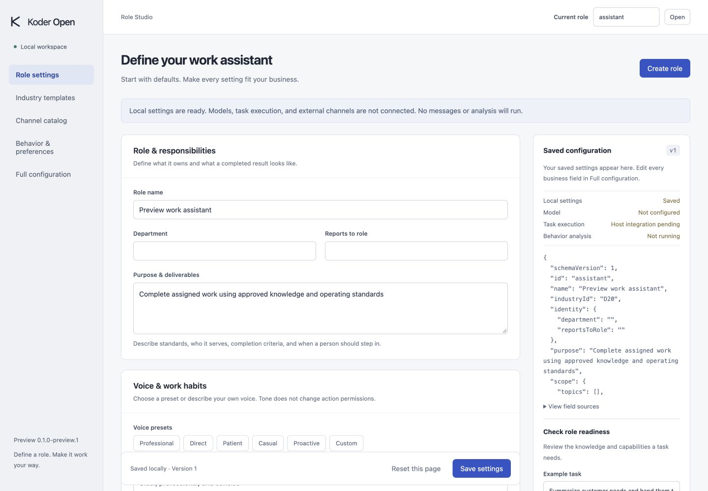

# Koder Open CLI

**Define the role. Set the standards. Make AI work your way.**

Koder Open CLI is a configurable AI role platform from [KarmenLoop](https://karmenloop.com). It is designed to turn general-purpose AI into a work assistant that follows your business standards, scope, methods, workflows, habits, and voice.

Start with ready-to-edit defaults. Shape every business setting. Bring the role to the websites, collaboration tools, and messaging channels where work happens.

**Status:** 0.1.0-preview.1 · installable macOS Apple Silicon configuration preview · live integrations in progress.

**Repository scope:** English product documentation, sanitized preview images, and the download installer. Proprietary executable packages are distributed as Release assets. Product source code, private host components, and user data are not published in this Git tree.

## Download the independent preview

**[Download Koder Open CLI 0.1.0-preview.1 for macOS Apple Silicon](https://github.com/KarmenLoop/koder-open-cli/releases/download/v0.1.0-preview.1/koder-open-0.1.0-preview.1-darwin-arm64.tar.gz)** · [Release notes and checksums](https://github.com/KarmenLoop/koder-open-cli/releases/tag/v0.1.0-preview.1)

This package includes the runtime and requires no separate Node.js installation. It uses the independent `koder-open` command and version series.

Install from Terminal:

```sh
curl -fsSL https://raw.githubusercontent.com/KarmenLoop/koder-open-cli/main/install/koder-open.sh | sh
"$HOME/.local/bin/koder-open" studio
```

Open the local URL printed by Studio. Or extract the downloaded archive and run `sh install.sh` inside it. See [installation, upgrade, rollback, and uninstall instructions](docs/INSTALLATION.md).

**Platform:** macOS 11+ on Apple Silicon. **Distribution:** proprietary preview, ad-hoc signed, not Apple notarized. Additional platforms are still pending. This preview provides local role configuration and synthetic checks; models, live business channels, and active behavior analysis are not connected.



*Actual local development preview with synthetic configuration. Models, live task execution, and external channels are not connected in this view.*

## Your role, your way

Configure responsibilities, job titles, departments, reporting relationships, service audiences, operating rules, business boundaries, work methods, orchestration, habits, wording, tone, language, and delivery standards.

The complete product is designed for three levels of control: describe a change in natural language, use a guided settings interface, or manage structured configuration. All three will use the same validated, versioned settings. The current preview includes forms and full configuration editing; natural-language editing and the complete setup wizard are planned.

Every business module starts with defaults. Users can override, replace, combine, reset, and version settings. Full customization does not bypass platform permissions, identity checks, or action approval.

## Built around the Koder ecosystem

Koder Open CLI is the role and channel configuration layer for the Koder ecosystem. Its architecture reuses existing model, session, tool, task, memory, skill, and scheduling foundations through reviewed host interfaces.

The planned runtime supports real work: authorized actions, human approval, handoff, durable waiting, dynamic follow-up, cancellation, recovery, and verified results. A preview or a model response is never treated as proof that a message was sent or a business action completed.

## Behavior analysis that users control

A user-behavior-personalization skill is part of the product design and is bundled in the private local preview. It is disabled by default, and its analysis host is not connected yet.

The complete system separates personal preference learning, business activity summaries, and automatic role tuning. Users choose **Off**, **Suggest**, or **Adapt within approved scope**. Evidence, source references, counterexamples, consent, version checks, correction, forgetting, and rollback are integral to the design.

A temporary request stays temporary. Another person's message does not become your preference. Automatic adaptation cannot expand permissions or change recipients. Users can replace the skill and customize its permitted behavior.

## All business domains remain in scope

Twenty domain families cover customer support, sales, marketing, content and brand, administration, HR and training, finance, procurement, project delivery, engineering and IT, data and decisions, commerce, manufacturing and quality, education, professional services and research, local services, communities, cross-border work, business management, and custom industries.

The current preview provides editable configuration seeds for all twenty. Full professional packs, domain reviews, and representative live tasks are still planned. Each completed domain pack requires at least ten professional acceptance cases.

## Channel roadmap

The full target catalog includes:

- Website widgets and standalone service pages; HTTP APIs and webhooks.
- Feishu, Lark, WeCom, Telegram, DingTalk, Slack, Discord, and WhatsApp Business.
- WeChat iLink, Official Accounts, Customer Service, and Mini Programs/H5.
- Microsoft Teams, email, CLI/TUI, and ACP editor sessions.

These are **18 development targets**, not a claim of 18 working integrations. Verify each installation and capability independently: connection, reception, reply, proactive messaging, attachments, interactions, history, membership, and receipt queries. Platform eligibility and commercial-use conditions must be checked for the actual account and interface; WeChat iLink remains explicitly unverified.

The connector roadmap also covers eleven categories: knowledge/documents, CRM, support tickets, commerce/orders, ERP/inventory, OA/approvals, HR/training, projects, calendars, spreadsheets/data warehouses, and custom APIs.

## What works in the local preview

| Available locally | Still in development |
| --- | --- |
| English Role Studio, CLI, and macOS Apple Silicon installer | Integrated live role task execution |
| Role creation and editable defaults | Complete natural-language setup wizard |
| Twenty domain configuration seeds | Professional industry packs and reviews |
| Eighteen-channel capability catalog | Connected and verified business channels |
| Full configuration editing and field sources | Business connectors and website widget |
| Save/reopen, conflict checks, reset, and rollback | Cross-device shared memory integration |
| Synthetic role-readiness checks | Running behavior analysis and controlled adaptation |
| Bundled, disabled behavior skill | Additional platforms, server deployment, and independent product QA |

The preview passed 47 source tests and 13 installer/runtime/distribution acceptance checks. These cover native binary startup, HTTP save/reopen, download checksums, installation, repeated installation, upgrade, rollback, collision protection, tamper rejection, and uninstall with user data retained. Browser save/reopen was also verified against the installed executable. These checks do not establish live channel or production readiness.

## Additional preview views

[Behavior and preference controls](media/behavior-preferences.jpg) · [Mobile layout](media/role-studio-mobile.jpg). These views show local configuration only.

## Read the plan

- [Complete product specification](docs/PRODUCT_SPEC.md): defaults, full customization, behavior analysis, all domains and channels, operating model, and acceptance requirements.
- [Development plan](docs/DEVELOPMENT_PLAN.md): twenty work packages, dependencies, milestones, verification, and release criteria.

The complete acceptance target includes 200 professional domain cases, 360 configuration/routing combinations, every named real channel entry, eleven connector categories, macOS/Windows/Linux, distinct-device recovery, and independent QA. Delivery dates will follow verified dependencies and resourcing.

## Availability

The independent configuration preview is available from the Release linked above. The complete AI role runtime remains in development. Local use, BYOK, and compatible installed local models remain part of the product direction; external model and platform costs depend on the services selected.

## License and source availability

Koder Open CLI is proprietary software. Its product source code remains private. The executable preview is provided under the bundled [Proprietary Preview License](docs/PREVIEW_LICENSE.txt), which permits installation and internal use. Public documentation, images, and original branding remain **all rights reserved**; see [LICENSE](LICENSE). Bundled Node.js components retain their own licenses.

This repository is not licensed under GPL-3.0. Separately released [Koder CLI](https://github.com/KarmenLoop/koder-cli) components and third-party materials retain their respective licenses. This notice does not relicense them or grant rights to the private Koder kernel.

Learn more about KarmenLoop at [karmenloop.com](https://karmenloop.com).
