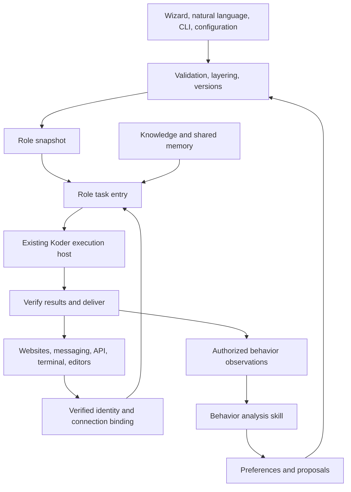

# Koder Open CLI — Product Specification

Version 1.2 · October 19, 2026 · English edition

This specification defines the complete product scope. It is a development target, not a statement that every feature is available. The English edition updates the shipped language to English; users can customize role languages. The software remains proprietary. Public GitHub materials contain product information and a download installer. The proprietary macOS arm64 configuration-preview executable is a separate Release asset; product source code remains private.

## 1. Product definition

Koder Open CLI turns a general AI model into a configurable work role. A person or team defines responsibilities, standards, scope, methods, orchestration, habits, wording, job relationships, knowledge, tools, and delivery criteria, then connects the role to approved business channels.

The full product covers internal operations, customer-facing websites, content and growth, professional verticals, and user-defined roles. All 20 domains and 18 named channels remain in scope. Phased delivery determines sequence; it does not remove domains or replace named integrations with a generic API claim.

Success means a user can begin with defaults, inspect and change every business setting, connect their model and resources, complete verifiable work, resume after interruption, and control evidence-based behavior adaptation.

## 2. Users and authority

| User | Primary responsibility | Entry point |
| --- | --- | --- |
| Individual or small team | Personal assistant, habits, and workflows | Wizard, Studio, CLI |
| Organization administrator | Roles, data, models, connections, and audit | Studio and deployment controls |
| Business owner | SOPs, knowledge, scripts, approvals, and acceptance | Role editing and evaluation |
| Frontline operator | Tasks, approvals, correction, and handoff | Business channels |
| Customer or visitor | Requests, documents, and results | Website widget or approved channel |
| Developer or implementation provider | Industry packs, connectors, installation, and upgrades | Private CLI and extension contracts |

Configuration, conversation participation, approval, and deployment have separate authority. Talking to a role does not grant management access. Service providers see only delegated customer spaces. Credentials never travel with templates.

## 3. Relationship to Koder CLI

Use an independent `koder-open` entry point and role-configuration layer over existing Koder execution foundations. Reuse model/session transport, cancellation, bounded context, tools, tasks, gateway adapters, memory, skill maintenance, and scheduling through reviewed host interfaces. Do not create a second identity issuer, execution ledger, synchronization authority, or scheduler.

KARMEN BOT autonomous goals retain their existing ownership and Core contracts. Existing Koder CLI licensing remains separate and unchanged. This project does not publish the private kernel or grant rights to separately licensed components.

## 4. Product objects and flow

Organization identifies the individual or business through trusted identity. Space holds members, roles, knowledge, tasks, connections, and sharing policy. RolePack defines a job. IndustryPack combines roles, knowledge structure, connectors, and evaluations. Binding links a specific installation/account to a role, space, and audience. ConfigSnapshot records an immutable version, digest, field sources, and locks. Task references point to existing Core tasks. BehaviorEvent is a sourced observation; Preference is a scoped rule; Proposal is a candidate change; Release is a recoverable configuration/package/host combination.

Tasks record the snapshot they consume. Configuration changes do not replay completed actions or revive canceled tasks.

## 5. Ready defaults and simple setup

Distinguish three readiness states: configuration-ready without an account; model-ready after verifying the selected API or installed local model; and business-ready after resources, permissions, channels, and role acceptance are verified. An offline configuration check is not an offline AI model. Remote APIs require network access; offline inference requires an installed compatible local model.

The planned six-step setup is: describe the role → choose a template → select knowledge and a model → confirm action and learning scope → try examples → connect and publish. Each step saves a draft. Missing connections do not prevent editing or synthetic checks.

Natural-language editing produces a reviewable change with field paths, old/new values, scope, reason, and impact. It uses the same validation and version service as forms and files. Permission, audience, external communication, and learning-scope changes require an authorized administrator.

| Setting | Shipped default or product rule |
| --- | --- |
| Language and voice | English, professional, conclusion first, balanced length; six style presets |
| Out-of-scope requests | Explain scope and use the configured handoff; otherwise identify what is missing |
| Facts and sources | Current approved sources; clarify gaps and show conflicting evidence |
| Tools | No requested tools in the base role; live actions require verified host authority |
| Public customer roles | No arbitrary shell or host filesystem access |
| Query retries | At most three total attempts for idempotent queries |
| Unknown writes | Query the original operation before any retry |
| Follow-up | Recalculate using urgency, deadlines, commitments, and working hours |
| Quiet hours | 22:00–08:00 for ordinary notifications |
| Approval wait | 300 seconds of interactive waiting, then durable waiting or overdue state; no automatic approval |
| Task limits | 15 minutes per task, 120 seconds per tool, two concurrent tasks per space, one writing task per subject |
| Model | Unconfigured; BYOK and compatible local model choices, with no silent provider substitution |
| Learning | Bundled skill, off before explicit choice; suggest as the initial enabled mode |
| Tentative evidence | Three independent observations across dates or tasks; explicit lasting preferences are recorded separately |
| Reflection | After enabling, 02:00 in the user's time zone, up to four model calls per day; catch up through the host |
| Automatic tuning | Off; separately authorize allowed fields and evaluated versions |
| Retention | Twenty configuration/profile versions; 30 days of reflection and redacted summaries; source conversations follow space policy |
| Proactive contact | Current-conversation replies only until recipients, purpose, timing, and stop conditions are configured |
| Notifications | Quiet while stable; meaningful changes, completion, failure, approvals, and actionable needs may notify |

Existing explicit settings survive upgrades. Local use and BYOK are intended to remain available without mandatory membership; external models, hosting, and platform resources follow the user's selected services. No pricing or availability promise is made for an unreleased product.

## 6. Complete customization

Users can edit job title, department, responsibilities, audience, reporting relationships, goals, success criteria, boundaries, handoff and stop conditions, mandatory and forbidden steps, evidence standards, approvers and thresholds, decision methods, workflows, working hours, reporting cadence, tone, terminology, format, knowledge, retrieval, memory policy, skills, models, tools, channels, evaluations, releases, and rollback.

Full customization concerns business behavior. Trusted systems still determine identity, operating-system permissions, platform grants, and real execution receipts. A configuration file cannot fabricate those facts.

Layering is product defaults → industry → organization → space → role → channel → current task. Apply confirmed preferences only to authorized, unlocked expression fields; inferred habits create proposals. Objects merge by field; ID-based lists use explicit add/replace/remove; deletion is explicit. Null means clearing only where the schema allows it. Effective tool and data permissions are the intersection of current subject, space, role, channel, and task authority.

Use JSON for structured configuration and Markdown for long-form guidance. Reject unknown core fields; vendor extensions use namespaced fields. Defaults: 256 KiB per document, 1 MiB after expansion, depth eight, and 128 workflow nodes. Show migration reports and differences rather than discarding fields. Compare expected versions on commit, retain old state on failures, explain conflicts, and publish immutable snapshots.

Role packs contain a manifest, role defaults, operating standards, playbook, voice guidance, workflows, knowledge references, skills, evaluations, and a changelog. Validate paths, size, digests, compatibility, and permission changes before import. Reading a skill does not run scripts. Export excludes secrets, sessions, customer records, approvals, and executable queues.

## 7. Spaces, identity, and memory

Support departmental, project, channel-operation, and personal spaces. Names and folders are not identities. Visitors receive restricted customer context; verified customer linking is required before continuing the same business across entries. Never automatically join a public customer to an internal organization space.

Existing linked spaces keep their approved cross-channel/device and group-members sharing policies. Show the audience and policy during binding. Share authorized facts without copying API keys, execution approvals, ownership, leases, or runnable queues. Use stable host-verified identity for cross-device continuity. Memory deletion, revocation, tombstones, concurrent append, interrupted synchronization, and reconnect must preserve isolation and prevent deleted content from returning.

## 8. Behavior analysis skill

Separate three controls: personal preference learning, redacted business activity analysis, and automatic role tuning. Off performs no profile reads/writes or analysis. Suggest generates proposals. Adapt changes only approved fields after evaluation, current consent, evidence, and version checks. Enabling a mode in an unconnected preview saves policy intent only.

Personal learning distinguishes explicit facts, explicit preferences, repeated signals, temporary instructions, and transient states. Keep confirmed, tentative, and observation-only levels. Deduplicate source messages. Quoted material, another speaker, tool output, silence, and the agent's own response cannot confirm a preference. Current instructions and latest explicit corrections take precedence. Retrieve only the three to five relevant rules within model budgets.

Each change records user/space scope, source and message references, dates, classification, counterevidence, permitted fields, consent revision, expiry, and base version. Show generated, saved, loaded, and applied separately. Allow users to inspect, correct, reject, export, stop, and forget. Recheck subject, consent, deletion generation, and version before late results commit. Failed writes do not advance cursors. No new content means no model call.

Business analysis may study repeated clarifications, task friction, handoff reasons, verified completion, corrections, and direct feedback. Define time windows, denominators, sample sizes, missing data, cancellation, unknown outcomes, and unfinished work. Do not invent satisfaction, personality, causal improvement, or percentage gains without evidence.

Users can replace the skill and customize evidence thresholds, metrics, rules, models, prompts, and outputs. A lower threshold can create more tentative candidates; it cannot turn inference into confirmed fact. Manual locks and current user choices prevail. Automatic tuning cannot expand permissions, recipients, or paid-service commitments. Retain reversible versions and prove actual consumption in later work.

## 9. All business domains

Each complete industry pack needs editable roles, rules, methods, voice, knowledge structure, tools, workflows, at least ten professional cases, professional review, and a representative live task. Current local templates are configuration seeds only.

| ID | Domain | Default roles | Default workflow |
| --- | --- | --- | --- |
| D01 | Customer support | Reception, troubleshooting, and after-sales coordination | Identify the issue → check policy → collect facts → resolve or hand off; record the ticket and result |
| D02 | Sales & business development | Product advisor, lead assistant, and quote coordinator | Understand needs → match products → use approved prices → approve exceptions → follow up |
| D03 | Marketing & growth | Campaigns, channel operations, and growth analysis | Set a goal → prepare assets and audiences → approve → verify publication → review results |
| D04 | Content & brand | Editing, brand copy, and multilingual review | Receive the brief → gather sources → draft → check brand standards → approve and version |
| D05 | Administration | Administrative assistant and meeting coordinator | Receive a request → check resources → draft arrangements → confirm → notify and record |
| D06 | HR & training | Policy support, recruiting coordination, and training assistance | Check policy → verify identity and scope → explain or arrange → escalate to the owner |
| D07 | Finance & operations | Expense checks and business reporting | Collect records → check rules → flag exceptions → obtain owner review; no autonomous payments |
| D08 | Procurement & supply chain | RFQ assistant and supplier coordinator | Verify contact capability → verify supplier sources → request approved quotes → compare → approve and track delivery |
| D09 | Project delivery | Project coordinator, progress assistant, and acceptance reviewer | Define the goal → map dependencies → execute or wait → escalate risk → verify delivery evidence |
| D10 | Engineering & IT | Development assistant, operations intake, and knowledge support | Diagnose → propose → make approved changes → verify → recover; use existing Koder tools |
| D11 | Data & decisions | Data queries, metric explanations, and reporting | Define metrics → run authorized queries → check quality → analyze → report with sources |
| D12 | Commerce & retail | Product advisor and order support | Match products → verify stock and orders → follow service procedures → escalate exceptions |
| D13 | Manufacturing & quality | SOP support, quality records, and production coordination | Check the current SOP → gather site facts → apply the checklist → escalate deviations |
| D14 | Education & learning | Learning assistant, course advisor, and academic coordinator | Define goals → assess needs → explain and practice → collect feedback → adjust the plan |
| D15 | Professional services & research | Research and project assistance | Clarify the question → find reliable sources → evaluate evidence → report → obtain professional review |
| D16 | Local services | Booking, reception, and service coordination | Explain services → verify availability → draft a booking → confirm and remind |
| D17 | Communities & membership | Community reception, knowledge management, and event coordination | Check community rules → assess the question or event → respond → escalate → summarize |
| D18 | Cross-border & multilingual | Multilingual support and cross-time-zone coordination | Identify language → verify business facts → localize the response → follow up across time zones |
| D19 | Business management | Management assistant and task coordinator | Set goals → assign ownership and dependencies → verify progress → surface decisions → review operations |
| D20 | Custom industries & roles | Custom role owner | Build responsibilities, data, tools, workflows, and evaluations from a blank role or a template |

Domain experts or customer-provided acceptance criteria validate professional content. Changing a role name does not establish professional readiness. D20 supports new user-defined industries through the same packaging and evaluation process.

## 10. All channel targets

Every connection instance reports connect, receive, reply, proactive, attachment, interaction, history, membership, and receiptQuery separately. States are available, permission-required, unsupported, or unverified, with account scope, verification time, and invalidation conditions. All Open CLI live channel integration remains unverified in the current preview.

| ID | Channel | Integration approach |
| --- | --- | --- |
| C01 | Website widget & service page | Planned restricted visitor entry, embedded widget, and server-side sessions |
| C02 | HTTP API & webhooks | Planned authentication, event signatures, and receipt queries |
| C03 | Feishu | Existing Koder adapter source; application-bot integration pending |
| C04 | Lark | Separate domain, installation, and credential configuration required |
| C05 | WeCom | Existing Koder intelligent-bot long-connection entry; integration pending |
| C06 | Telegram | Existing Koder adapter source; verify the selected receive mode |
| C07 | DingTalk | Existing Koder adapter source; verify each capability |
| C08 | Slack | Existing Koder adapter source; verify installation and scopes |
| C09 | Discord | Existing Koder adapter source; verify server and channel permissions |
| C10 | WhatsApp Business | Existing Koder adapter source; verify business eligibility and messaging capabilities |
| C11 | WeChat iLink | Existing QR and polling source; account eligibility and commercial scope remain unverified |
| C12 | WeChat Official Accounts | Planned dedicated adapter; independent from iLink |
| C13 | WeChat Customer Service | Planned dedicated adapter; independent from WeCom group bots |
| C14 | WeChat Mini Programs & H5 | Planned business component and backend binding |
| C15 | Microsoft Teams | Planned official-application adapter |
| C16 | Email | Reuse a reviewed email connector or add a host adapter |
| C17 | CLI & TUI | Local configuration CLI available; business task integration pending |
| C18 | ACP editors | Reuse existing Koder ACP sessions; role integration pending |

Verify private/group entry, mentions, threads, duplicate events, reconnect, approval/rejection, account changes, and revocation where applicable. Feishu and Lark retain separate domains and installations. WeCom, WeChat iLink, Official Accounts, Customer Service, and Mini Programs are distinct products. iLink account eligibility and commercial use require separate verification. Do not infer proactive messaging, attachment, history, or business eligibility from a successful connection.

Use official or explicitly authorized interfaces. New channels enter the same registry and acceptance process. A blocked integration remains incomplete; do not use browser automation to circumvent platform access requirements.

## 11. Business connectors

The complete connector catalog has eleven categories: knowledge/documents, CRM/leads, support tickets, commerce/orders, ERP/inventory, OA/approvals, HR/training, projects/tasks, calendars, spreadsheets/data warehouses, and customer-built APIs.

Each connector declares input/output schema, capability, identity and resource scope, query versus side effect, idempotency, original-operation queries, receipts, and recovery. Use existing tool/MCP hosts. Keep credentials outside model context. External content supplies data, not management authority. Test a synthetic business example and at least one controlled representative integration per category; generic HTTP success does not establish every vendor integration.

## 12. Workflows and persistent execution

Support input, lookup, decide, action, parallel, approval, wait, handoff, verify, deliver, and compensate nodes. Define typed results, artifact references, dependencies, timeouts, failure paths, budgets, and compensation. Conditions use declarative comparisons, not arbitrary JavaScript.

Map work onto existing Core tasks. Persist wait conditions and wake the original task through the original scheduler. Recalculate follow-up timing dynamically. Multiple roles share only needed facts and retain separate authority and knowledge scopes. Human handoff pauses relevant actions; resumption rechecks facts, versions, and permission.

The required live chain is same-task authority → real tool → persistent receipt/artifact → verification → model continuation. UNKNOWN requires querying the original operation. Model changes, restarts, retries, or channel switches cannot duplicate writes. Pause, cancellation, revocation, and recovery are handled by the original Core. Old approval never restores revoked authority.

## 13. Knowledge and professional quality

Support documents, approved web sources, FAQs, structured records, and authorized business queries. Track source, version, applicable roles, visibility, freshness, and expiry. Revocation invalidates retrieval and citation. Prefer applicable approved sources; expose conflicts, uncertainty, and missing information. Templates use synthetic examples and never invent customer prices, orders, or commitments.

## 14. Studio, CLI, and accessibility

The complete Studio navigation includes overview, spaces/roles, knowledge, workflows, skills, behavior/preferences, channels/connections, tasks/approvals, evaluation, and deployment/versions. The current preview implements a smaller configuration-focused surface.

Role editing covers purpose, standards, methods, voice, tools, knowledge, workflows, and tests. Reveal advanced controls progressively. Show default/current values, sources, locks, versions, and reset. Keep natural-language and structured editing consistent. Preserve drafts after errors and settings after disconnects.

Show draft, invalid, waiting for connection, synthetic check, waiting for approval, publishing, published, partly available, expired, paused, and rolled-back states. Support keyboard operation, visible focus, labels, screen-reader feedback, responsive layouts from 320 pixels, English shipped UI, and configurable role language.

The full CLI covers init, studio, config show/diff/set/reset, role create/import/export, skill list/configure, behavior status/review/forget, channel connect/verify, run, task resume/cancel, eval, deploy plan/apply, status, and rollback. Current availability must be documented separately. Non-interactive mode never auto-approves actions.

## 15. Deployment and operation

Target macOS, Windows, Linux, persistent local service, self-hosted servers, containers/private environments, and managed deployment. Verify computer-control capability per actual host platform. Managed offerings do not remove local BYOK.

Deployment fixes package/configuration digests, checks dependencies/permissions/ports/storage, performs a synthetic check, applies a reviewed plan, checks health, and verifies a real channel task. Reuse host service ownership so only the valid owner handles an inbound event. Studio binds to loopback by default; remote administration requires explicit binding and authentication. Website visitors use short-lived server sessions bound to audience and space, never provider secrets.

Separate process health, model connectivity, inbound reception, outbound reply, tools, and pending tasks. Redact logs and report references, versions, usage, timing, and outcomes without secrets or hidden reasoning. Backup and rollback restore data/configuration; Core reconciliation controls execution and never replays historical writes.

## 16. Quality and release acceptance

Track configuration completion and elapsed time without premature speed promises; verified completion over valid terminal tasks; handoff rates and reasons; correct preference application and non-application; evaluation/version/rollback evidence; recent channel receipts; actual usage and processing/wait times. Missing usage is unknown, not zero.

Every domain needs at least ten cases: successful delivery, missing knowledge, conflicting sources, scope violation, approval, rejection, unknown effects, cancel/resume, behavior correction, and cross-channel continuation. Minimum full scope: 200 professional cases and 360 domain/channel routing combinations. Routing enumeration is configuration coverage, not 360 live business acceptances.

Validate all 18 real channel entries, all 20 representative domain tasks, eleven connector categories, three operating systems, distinct-device recovery, consent and deletion controls, isolation, approved positive cases, and independent QA. Preserve failures and unverified limits. Do not turn constant denial or reduced assertions into a pass.

## 17. Requirement traceability

| ID | Required outcome | Tasks |
| --- | --- | --- |
| R01 | Independent entry with shared execution foundations | T01, T07, T18 |
| R02 | Ready defaults and offline configuration checks | T02, T12, T17 |
| R03 | Full business customization | T03, T05, T12 |
| R04 | One contract for natural language, wizard, and files | T03, T12, T18 |
| R05 | Identity, spaces, roles, and authorization | T04, T07 |
| R06 | Professional knowledge with sources | T06, T17 |
| R07 | Business workflows and multi-role collaboration | T08 |
| R08 | Durable tasks and dynamic follow-up | T07, T08, T09 |
| R09 | Bundled, replaceable skills | T05, T11 |
| R10 | User behavior and business analysis | T10 |
| R11 | Consent, preferences, and forgetting | T09, T10 |
| R12 | Authorized automatic tuning | T11 |
| R13 | All 18 channel targets | T13, T14, T15, T18 |
| R14 | Enterprise tools and systems | T16 |
| R15 | Shared memory and cross-device continuation | T09, T14, T15 |
| R16 | Verified model capabilities, BYOK, and budgets | T07, T18 |
| R17 | All 20 domains and user-built industries | T17 |
| R18 | Deployment, upgrades, recovery, and operation | T18, T20 |
| R19 | Accessible UI and configurable role languages | T12, T13, T19 |
| R20 | Verifiable quality and delivery | T19, T20 |

## 18. Milestones and completion

Develop foundations/configuration, business execution, memory/analysis, full product/channel/domain coverage, then deployment/independent acceptance. A scoped milestone may ship with explicit limits; the complete product requires evidence for every R, D, and C entry. Dates depend on verified host handoffs, staffing, platform accounts, and professional reviewers. No complete-product delivery date is asserted yet.

## 19. Management and business API intent

Management sessions may list accessible spaces, inspect/edit/version role configuration, preview changes, publish snapshots, inspect tasks, pause/resume/cancel, decide approvals, manage independent behavior policies and proposals, forget memory, and inspect connection capabilities. Business sessions may create authorized tasks, query permitted results, and use restricted website sessions. Platform callbacks require verified signatures and durable deduplicated intake.

All changes compare expected versions. Sensitive fields expose references or redacted values. Separate authentication errors, permission denial, version conflict, size limits, rate limits, and unavailable dependencies. Accepted task intake is not final completion; query the task and its actual receipts. These are planned contracts rather than current public endpoints.
